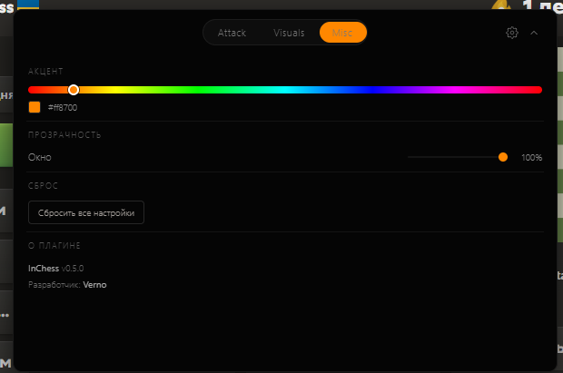
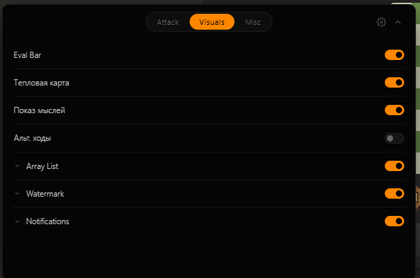
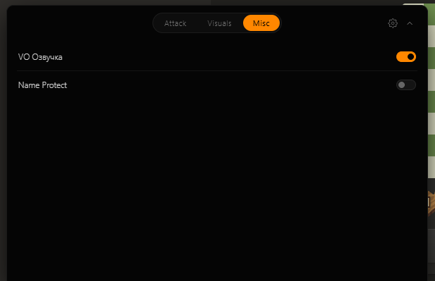

[🇬🇧 English](README_EN.md) | 🇷🇺 **Русский**

# InChess

Высокопроизводительное браузерное расширение для анализа и автоматизации шахмат.

# Дисклеймер

Данное программное обеспечение предназначено исключительно для образовательных и исследовательских целей. Автор не несёт ответственности за любое неправомерное использование инструмента или нарушение условий использования сторонних сервисов (ToS). Используйте на свой страх и риск. Автор не несёт ответственности за блокировку аккаунтов или любые другие последствия, возникшие в результате использования данного программного обеспечения.

  
  

  
  

## Возможности

### Attack (Атака)
- **Детектор** — анализ позиции в реальном времени с настраиваемой глубиной поиска (Auto / 2–7).
- **Предикты** — показывает предполагаемый следующий ход соперника.
- **Ограничение Elo** — имитация слабого игрока через намеренные ошибки в заданном диапазоне. Уровни слайдера: `Авто` (берёт Elo соперника из DOM) → 800 → 1200 → 1600 → 2000 → 2400 → `Макс` (без ограничений).
- **Авто-ход** — играет лучший ход за вас. Включает:
  - Случайную задержку между ходами (настраиваемый минимум/максимум).
  - Вариант с фиксированной задержкой.
  - Человеческий тайминг: гауссово распределение, редкие «задумчивости» (×1.8–3.0), редкие быстрые ходы (×0.5), множитель по сложности хода.

### Visuals (Визуал)
- **Eval Bar** — шкала оценки позиции в сантипешках рядом с доской.
- **Тепловая карта** — подсветка угроз, опасных клеток и свободных взятий.
- **Показ мыслей** — рисует текущий рассматриваемый движком ход анимированной пунктирной линией.
- **Альтернативные ходы** — показывает 2 альтернативных хода с убывающей прозрачностью.
- **Array List** — плавающий HUD со списком активных функций. 4 стиля (`Inroute`, `Celestial`, `Minced`, `Nursultan`) и 2 позиции (слева/справа).
- **Watermark** — плавающий водяной знак со счётчиком функций, ходов и винрейтом. 4 стиля (`Inroute`, `Rich`, `Nursultan`, `Minced`) и 2 позиции.
- **Уведомления** — всплывающие уведомления о прогрессе анализа, ошибках и успехе. Два стиля (`Inroute`, `Celestial`), отдельные тумблеры по типам.

### Misc (Разное)
- **VO Озвучка** — звуковые эффекты для взятия фигур, блестящих ходов, старта игры, победы и поражения.
- **Name Protect** — маскирует ник и аватар под бренд InChess в реальном времени.

### Settings (Настройки)
- **Акцент** — полноценный HSV-пикер цвета для акцента во всём интерфейсе.
- **Прозрачность** — слайдер прозрачности главного меню.
- **Сброс** — очищает все сохранённые настройки.

### Ядро движка
- Поиск альфа-бета с итеративным углублением.
- Aspiration windows для более быстрого отсечения.
- Таблица транспозиций на типизированных массивах (1М записей).
- Killer-ходы и history-эвристика.
- Quiescence-поиск для тактической стабильности.
- Сортировка ходов: TT-ход → взятия по MVV-LVA → killers → history.
- Продление на шахе, готовая структура для null-move.
- Определение ничьей по повторению позиции.
- Оценка: материал, piece-square tables, проходные пешки, пара слонов, ладья на открытой линии, сдвоенные/изолированные пешки, безопасность короля в миттельшпиле и эндшпиле.

### Хуманизация
- Движение мыши по кривой Безье (не по прямым линиям).
- Jitter (дрожание) на каждом шаге.
- Неравномерная скорость с замедлением к цели.
- Случайные микро-паузы до нажатия и до отпускания кнопки мыши.
- Гауссово распределение таймингов с редкими «задумчивостями» и «мгновенными ходами».
- Множитель задержки по сложности — тяжёлые позиции дольше, очевидные взятия быстрее.

### Стелс
- Работа на уровне DOM — без внедрения скриптов в страницу chess.com.
- Человеческие pointer-события (мимикрия под `isTrusted: true`).
- Весь анализ крутится в background-воркере расширения, не в контексте страницы.
- Серверный античит не видит расширение — он видит только тайминги и качество ходов, которые специально деградируются через Elo Limiter и хуманизированные задержки.

## Установка

1. Склонируй репозиторий.
2. Открой `chrome://extensions/` в браузере.
3. Включи **Режим разработчика** (тумблер в правом верхнем углу).
4. Нажми **Загрузить распакованное** и выбери папку проекта.
5. Зайди на `chess.com` — меню появится в правом нижнем углу.

## Как пользоваться?

1. Открой chess.com и начни игру.
2. Меню InChess появится автоматически в углу.
3. Включай нужные функции во вкладках **Attack**, **Visuals** и **Misc**.
4. Если хочешь играть безопасно — включи **Ограничение Elo** во вкладке Attack и поставь уровень `Авто`.
5. Для полной силы (только в приватных играх) — поставь Elo Limiter в `Макс`.

## Горячие клавиши

- `Alt + I` — скрыть / показать меню.

## Технологический стек

- JavaScript (ES6+)
- Chrome Extension API (v3)
- Кастомный CSS Grid
- Типизированные массивы для таблицы транспозиций
- SVG-оверлеи для визуализации доски

## Лицензия

MIT
