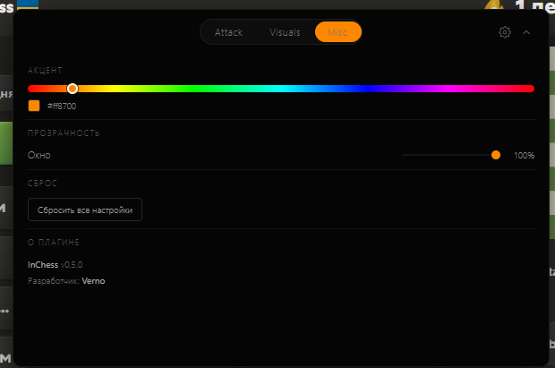
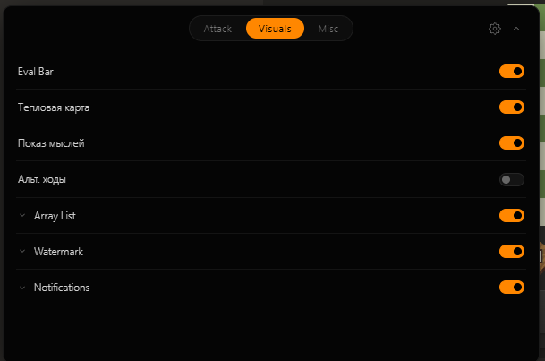
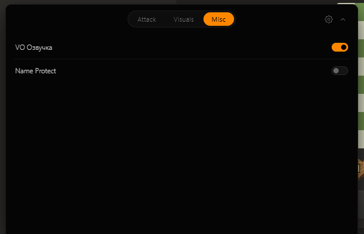

🇬🇧 **English** | [🇷🇺 Русский](README.ru.md)

# InChess

High-performance browser extension for chess analysis and automation.

# Disclaimer

This software is for educational and research purposes only. The author is not responsible for any misuse of the tool or any violations of third-party Terms of Service (ToS). Use at your own risk. The author assumes no liability for account bans or any other consequences resulting from the use of this software.

  
  

  
  

## Features

### Attack
- **Detector** — real-time position analysis with adjustable search depth (Auto / 2–7).
- **Predicts** — shows the engine's guess for the opponent's next move.
- **Elo Limiter** — simulates a weaker player by intentionally blundering within a configurable margin. Slider levels: `Auto` (reads opponent's Elo from DOM) → 800 → 1200 → 1600 → 2000 → 2400 → `Max` (no limit).
- **Auto-Move** — plays the engine's best move for you. Includes:
  - Random cooldown between moves (configurable min/max).
  - Fixed delay option.
  - Human-like timing: Gaussian distribution, occasional "deep think" (×1.8–3.0), occasional fast move (×0.5), complexity-based multiplier.

### Visuals
- **Eval Bar** — live centipawn evaluation bar next to the board.
- **Heatmap** — highlights threats, dangerous squares, and free captures.
- **Thoughts** — draws the engine's currently-considered move as an animated dashed line.
- **Alt Moves** — shows 2 alternative candidate moves with decreasing opacity.
- **Array List** — floating HUD listing active features and their state. Supports 4 styles (`Inroute`, `Celestial`, `Minced`, `Nursultan`) and 2 positions (left/right).
- **Watermark** — floating watermark with feature count, move count, and winrate. Supports 4 styles (`Inroute`, `Rich`, `Nursultan`, `Minced`) and 2 positions.
- **Notifications** — toast notifications for analysis progress, errors, and success. Two styles (`Inroute`, `Celestial`), per-type toggles.

### Misc
- **VO Voiceover** — plays sound effects for piece captures, brilliant moves, game start, win, and loss.
- **Name Protect** — masks your nickname and avatar with the InChess brand in real time.

### Settings
- **Accent Color** — full HSV color picker for the accent used across all UI.
- **Window Opacity** — opacity slider for the main menu.
- **Reset** — clears all saved settings.

### Core Engine
- Alpha-beta search with iterative deepening.
- Aspiration windows for faster pruning.
- Transposition table on typed arrays (1M entries).
- Killer moves + history heuristic.
- Quiescence search for tactical stability.
- Move ordering: TT move → MVV-LVA captures → killers → history.
- Check extension, null-move ready structure.
- Draw detection via position repetition.
- Evaluation: material, piece-square tables, passed pawns, bishop pair, rook on open file, doubled/isolated pawns, king safety in midgame and endgame.

### Humanization
- Bézier-curve mouse movement (not straight lines).
- Jitter on every move step (tremor simulation).
- Non-uniform speed with ease-out near the target.
- Random micro-pauses before pressing and before releasing the mouse.
- Gaussian-distributed timing with rare "deep think" and "instant move" outliers.
- Complexity-based delay multiplier — hard positions take longer, obvious captures are fast.

### Stealth
- DOM-based operation — no script injection into chess.com's page.
- Human-like pointer event dispatch (mimics `isTrusted: true`).
- All analysis runs in the extension's background worker, not in the page context.
- Server-side anti-cheat cannot see the extension — it only sees timings and move quality, which are intentionally degraded via Elo Limiter and humanized delays.

## Installation

1. Clone this repository.
2. Open `chrome://extensions/` in your browser.
3. Enable **Developer Mode** (toggle in the top-right).
4. Click **Load Unpacked** and select the project folder.
5. Go to `chess.com` — the menu will appear in the bottom-right corner.

## How to use?

1. Open chess.com and start a game.
2. The InChess menu appears automatically in the corner.
3. Toggle features you want in **Attack**, **Visuals**, and **Misc** tabs.
4. If you want to play safely — enable **Elo Limiter** in the Attack tab and set the level to `Auto`.
5. For full power (private games only) — set Elo Limiter to `Max`.

## Hotkeys

- `Alt + I` — hide / show the menu.

## Technical Stack

- JavaScript (ES6+)
- Chrome Extension API (v3)
- Custom CSS Grid
- Typed arrays for the transposition table
- SVG overlays for board visualization

## License

MIT
